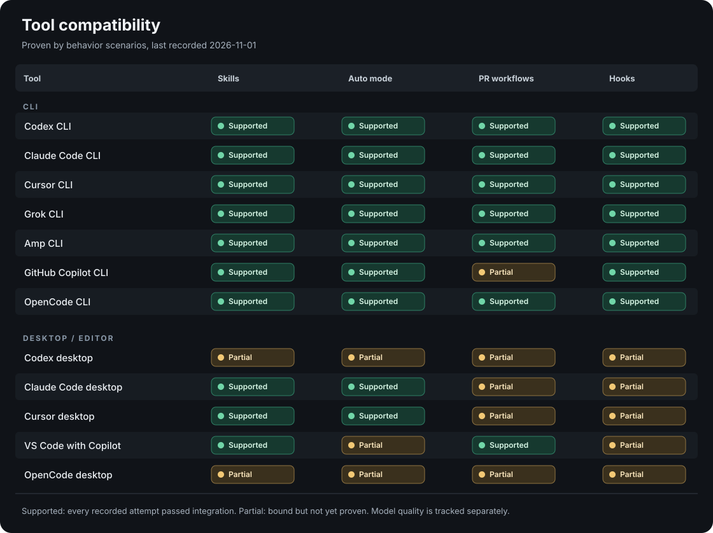
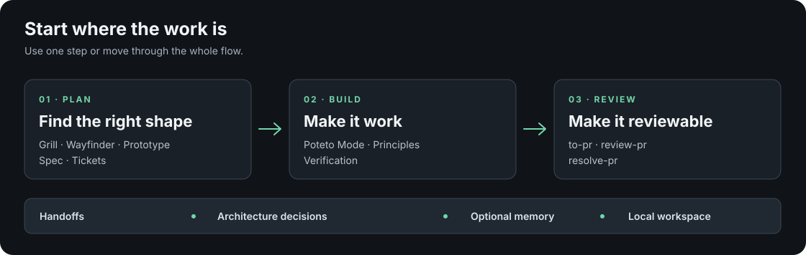

# bstack

bstack is my opinionated suite of skills, agents, and tools for planning, building, and reviewing software. It's part of the [ai-tools collection](../README.md).

It builds on [Lauren "poteto" Tan's PStack](https://github.com/cursor/plugins/tree/main/pstack) and [Matt Pocock's skills](https://github.com/mattpocock/skills). Some workflows reuse their work directly, others adapt it, and others draw inspiration from it. Their work is a huge part of the foundation. bstack adds my own skills, preferences, and integrations to connect it all into one stack. [Attribution](ATTRIBUTION.md) records what comes from where.

## Tool compatibility



**Supported** means bstack has an implemented path. **Partial** means there is a known gap or the app still needs live validation. **Not supported** means bstack has no binding for that capability. This describes bstack integration, not everything the tool itself can do. In particular, [OpenCode](https://opencode.ai/v2/docs/skills/) can discover `.agents/skills` and [`AGENTS.md`](https://opencode.ai/v2/docs/instructions/), but bstack does not yet install an OpenCode hook. The [installation guide](INSTALL.md) covers host selection and checks.

## What bstack adds



The [planning skills](sdlc/README.md), [engineering workflows](engineering/README.md), and [PR tools](engineering/to-pr/SKILL.md) work on their own or together. [Handoffs](shared/skills/handoff/SKILL.md) carry work between sessions; the [ADR process](shared/references/architecture-decisions.md) preserves the few decisions worth keeping. The [local workspace](workspace/README.md) holds Wayfinder maps and Kanban tickets without an external tracker.

The package is pinned and installs offline. It also includes [shared memory](shared/memory.md), the `recall` / `reflect` / `automate-me` session tools, and a [project PR policy](shared/references/pr-policy-template.md) that teams can customize. Planning and tickets are local today; GitHub, Jira, and Linear tracker adapters remain future work. GitHub PR publishing already works.

## Install

Choose either route. Both install the same bundled skills, dependencies, and customizations. Python 3.11+ on macOS or Linux is required. The full [installation guide](INSTALL.md) covers host selection, upgrades, and removal.

Installation includes a concise [seven-rule baseline](shared/references/baseline-agents.md) in your project instructions, even with automatic routing off. Existing guidance is preserved; project-specific initialization is optional. See [project instructions](INSTALL.md#project-instructions).

### With skills.sh

From the project where you want to use bstack, run:

```sh
npx skills add bbishdotdev/ai-tools --skill install-bstack
```

Choose your agent and project scope if prompted. Then open your agent in that project and ask:

> Install bstack in this project.

Or invoke `$install-bstack` in Codex, `/install-bstack` in Claude Code or Cursor. If the skill does not appear, start a fresh session in the same project.

The command downloads the installer skill from `main`. Your agent then runs it to install the full bstack package and checks it with `doctor`. To stay on a published version, use a [tagged skills.sh source](INSTALL.md#install-a-published-version) or the release download below.

To make the installer available across projects, add `-g` to the command above. Then invoke it from any target repo. Only the installer is global; each repo gets its own bstack package.

`bbishdotdev/ai-tools` identifies this repository; `--skill install-bstack` selects its installer. Keep both parts. You don't need to select all the skills in the development repository.

### From a download or clone

[Download bstack](https://github.com/bbishdotdev/ai-tools/releases/latest). Choose the `bstack-<version>.zip` asset and extract it. It contains one `bstack/` folder with the installer and the full package. GitHub's automatic source archives contain the development repository instead.

Ask your agent:

> Read SKILL.md in the extracted bstack folder and install bstack into my project at /path/to/my-project.

Or run this from the extracted folder:

```sh
python3 install.py --project /path/to/my-project
```

No Git, npm, skills.sh, or network access is needed during installation. A clone works too; use its bundled installer as described in [installation](INSTALL.md#from-a-download-or-clone).

After setup, start a fresh agent session to discover the skills. Ask "How do I use bstack?" or invoke `bstack-guide` for a short walkthrough. Its [offline reference guide](shared/skills/bstack-guide/assets/overview.html) has common use cases, routing and setup examples, workspace commands, and the full searchable catalog. Cmd/Ctrl+K searches the guide and its skill entries. New installs enable automatic routing and set project verification to `ask`; upgrades preserve both settings and selected tools. You can turn routing off or set verification to `off` or `auto`. Neither route fetches upstream latest.

See [installation and updates](INSTALL.md). The supported installation path is the project-local CLI bundle. Desktop discovery has [separate checks](INSTALL.md#claude-desktop-discovery); native plugin-manager installation is not part of this package.

## Pick a workflow

You can enter at any point. A bug fix does not need a Wayfinder map, and a planning session does not commit you to implementation.

| When you want to... | Start with... |
| --- | --- |
| Learn how the pieces fit or choose a starting point | `bstack-guide` |
| Understand existing code or why it works that way | `how` or `why` |
| Restate an answer plainly or select an engineering workflow | `bro` for a plain-language restatement; `poteto-mode` for workflow selection |
| Work through an idea with questions | `grill-me`, or `wayfinder` when decisions need to survive across sessions |
| Compare a design before building it | `prototype` |
| Turn accepted decisions into work | `to-spec`, then `to-tickets` if tickets help |
| Build from an approved plan or a clear request | `implement`; automatic routing can also select the engineering workflow for an ordinary prompt |
| Prepare, review, or respond to a PR | `to-pr`, `review-pr`, or `resolve-pr` |
| Catch up on prior work or improve a repeated agent workflow | `recall`, `reflect`, or `automate-me` |
| Audit stale Git worktrees before reclaiming disk | `worktree-cleanup` |
| Set this repo's PR review priorities | `configure-pr` |

Invoke a skill with your tool's native prefix, such as `$how` in Codex or `/how` in Claude Code and Cursor. [SDLC entries](sdlc/README.md) and [engineering entries](engineering/README.md) describe the individual workflows. The local [workspace app](workspace/README.md) and agent CLI share planning and ticket records.

Some workflows need more than the host running your chat. For example, [review-pr](engineering/review-pr/SKILL.md) calls authenticated GitHub, Codex, and Claude Code CLIs. Installing bstack does not sign in to those services. The [model doctor](INSTALL.md#check-optional-model-workflows) tests the selected models and supports local wrapper commands. Reviewers autonomously search and read the entire pinned repository through a bundled browser, with general-purpose tools disabled. No extra system packages or file-read approvals are needed. Running the app or tests during review is optional and needs a separate credential-free worker.

### What loads into context

Setup writes the seven-rule baseline and a short package pointer into the project's `AGENTS.md` and, for Claude, `CLAUDE.md`. Each public skill has a small discovery entry that points the agent to its bundled instructions. Those instructions call for only the dependencies the task needs; the whole collection is not inserted into every prompt. Customized `unslop` applies to prose.

Automatic engineering routing is on for a new install; upgrades keep the project's existing choice. Use `bstack-auto off` for manual routing. Its hooks carry a short reminder to load the router when needed; they do not inject the full skill corpus. The [installation guide](INSTALL.md#direct-skills-and-automatic-routing) covers the mode, session refresh, and host-specific limits.

Optional [shared memory setup](shared/memory.md) copies a user-wide runtime from the bundle for Codex, Claude, and Cursor's file bridge. Project installation leaves it inactive. It preserves existing notes and leaves legacy source-linked installations unchanged.

Review PR has a built-in Codex/Claude runner. Autonomous grilling still needs its calling host to coordinate the two participants; the live doctor checks CLI access before that exchange. Configuring an external tracker does not implement its operations or provision its services.

## Updates

[Changelog](CHANGELOG.md) collects unreleased changes and links to published release notes. Normal commits and pushes to `main` do not publish a release. A version tag starts the tested release workflow; [release preparation](RELEASING.md) covers when and how to do that.

## Work in the source tree

Paths below are relative to this `bstack/` folder:

- [Engineering](engineering/README.md) holds bstack-owned research, prototype, implementation and PR entries.
- `github/` holds the PR template and executable publishing helper, including the final overlap check and visual fallback. Setup copies the template into projects without one; the project owns its copy.
- [SDLC](sdlc/README.md) holds owned planning skills and integration decisions.
- [Workspace](workspace/README.md) provides Wayfinder, specs and Kanban, with shared SQLite operations for its browser UI and JSON CLI.
- `shared/` holds the router, adapters, maintainer verification, and [memory implementation](shared/memory.md).
- [Upstream](upstream/README.md) holds unchanged, pinned source inputs. Use the [catalog](audit/catalog.md) and [architectural audit](audit/pstack.md) when reviewing those inputs.
- `package/` and `scripts/` assemble and check `release/`, the complete consumer installation artifact.
- `audit/` records source reviews and verification results.

The repository's root `AGENTS.md`, `CLAUDE.md`, and hidden host configuration support development of bstack. Private work and runtime evidence stay in the repository's gitignored `.bstack/` folder.

## Maintain and verify

Keep customizations separate from the frozen sources. Follow [upstream updates](UPSTREAM.md) to compare a new snapshot or adopt a selected improvement. [layers.json](layers.json) records the sources and active adaptations.

Run these commands from the **ai-tools repository root**:

```sh
python3 bstack/scripts/layers.py check
python3 bstack/scripts/audit_pstack.py
python3 bstack/scripts/package.py build
python3 bstack/scripts/package.py check
```

The [verification skill](shared/skills/verify-bstack/SKILL.md) describes targeted source, package, installation, and live CLI checks. The [release manifest](release/bstack/manifest.json) is the current package inventory. Dated [package installation](audit/package-layout.md), [packaging](audit/packaging.md), [router](audit/router-poc.md), [fallback](audit/router-fallback.md), and [policy-layer](audit/bstack-layers.md) reports record what passed at those points in time, with their limits. New evidence goes in gitignored `.bstack/verification/`.

[Kanban and SDLC verification](audit/kanban-sdlc.md) records the 0.3.0 local app and planning-to-tickets checks. It is historical evidence, not a test of every skill in the current release.

[Portable memory verification](audit/portable-memory.md) records optional user installation, offline runtime independence, preservation and recovery tests, and the remaining live-recall and review limits.

Original bstack contributions use the shared [MIT license](../LICENSE). [bstack attribution](ATTRIBUTION.md) is the single maintained source for acknowledgments, ownership distinctions, and required notices. Generated releases carry that information with the installed bundle.
